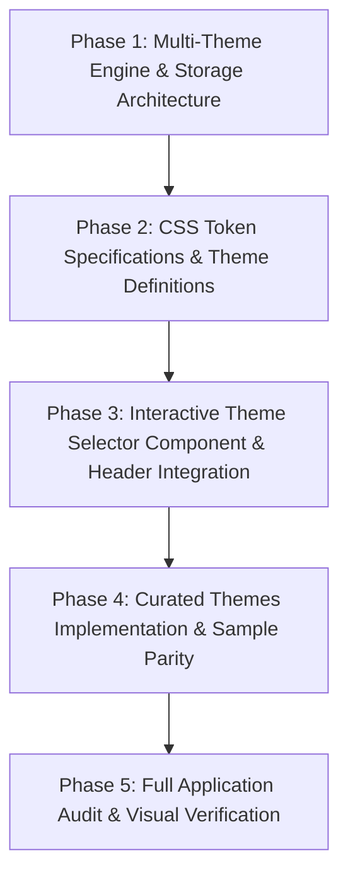

# Project Roadmap: OpenKuasa Multi-Theme System & Curated Design Engines

## Phase Overview

---

### Phase 1: Multi-Theme Engine & Storage Architecture
**Goal:** Build the foundation for multi-theme switching without FOUC, extending `src/lib/theme.ts` to support both theme presets and light/dark modes.
- Extend `src/lib/theme.ts` with `THEME_PRESET_KEY`, available preset constants, and reactive subscription hooks.
- Update `THEME_INIT_SCRIPT` for early pre-paint DOM attribute stamping (`data-theme="..."` and `.dark`).
- Add tests in `vitest` verifying theme resolution, persistence, and fallback logic.

### Phase 2: CSS Token Specifications & Theme Definitions
**Goal:** Structure `src/app/globals.css` with modular `@layer` / data-theme attributes mapped to Tailwind CSS 4 `@theme` and shadcn tokens.
- Define CSS custom properties per theme for:
  - Font families (`--font-sans`, `--font-mono`, `--font-heading`)
  - Border radii (`--radius`, `--radius-sm`, `--radius-lg`, etc.)
  - Surfaces & foregrounds (`--background`, `--foreground`, `--card`, `--border`, `--input`, `--ring`)
  - Accent colors and product module overrides (`--pc`, `--primary`)
- Ensure clean transitions and dark mode overrides per theme.

### Phase 3: Interactive Theme Selector Component & Header Integration
**Goal:** Create a polished, accessible Theme Selector dropdown/popover and mount it in key application headers.
- Create `src/components/theme/theme-selector.tsx` with accessible Radix popover / select.
- Implement theme preview chips displaying palette swatches and font sample.
- Integrate into `src/components/app/app-topbar.tsx`, `marketing-header.tsx`, and `account-shell.tsx`.
- Add a theme preview & selection section to the Settings page.

### Phase 4: Curated Themes Implementation & Sample Parity
**Goal:** Implement the full collection of curated themes from `.planning/THEMES_LIST.md` and reference prototypes in `sample_themes/`.
- Batch 1 (Tech & Minimalist):
  - Enterprise Hypervisor (Proxmox VE dense charcoal)
  - Monochromatic Swiss / Minimal (High-contrast hairline grid)
  - Industrial CRT Phosphor (Retro green terminal)
  - Deconstructed Blueprint / CAD Spec Sheet
- Batch 2 (Executive, Physical & Tactile):
  - Warm Executive Editorial (Parchment & midnight teal balance sheet)
  - Tactile Hardware Rackmount (Industrial steel & rocker switches)
  - 90s UNIX Workstation (IRIX 4Dwm directional bevels)
  - SCADA Command Console (Defense telemetry & amber radar)
  - Brutalist Financial Ledger (Zero-radius anti-design accounting table)
  - Analog Tape Deck / VU Console (Champagne aluminum & walnut)

### Phase 5: Full Application Audit & Visual Verification
**Goal:** Rigorously verify all core screens and components under every theme preset across both light and dark modes.
- Run `/impeccable audit` across core modules (Finance, CRM, People, Reach, Command).
- Verify contrast, typography readability, and table alignment under all themes.
- Smoke test all route screens with `scripts/smoke-routes.mjs`.
